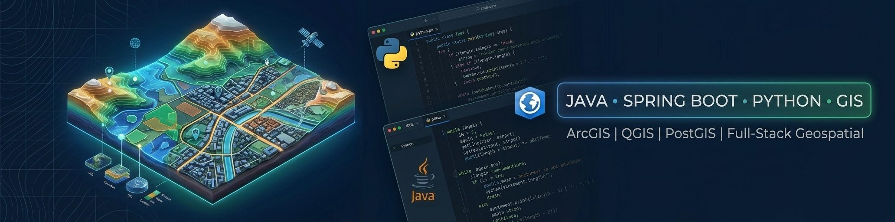

<div align="center">



# André Muniz — Portfólio

**Software Engineer · Full-Stack Java, Spring Boot & Angular · Geoprocessing (PostGIS/ArcGIS)**

🌐 **https://engenheiromuniz.github.io** · [LinkedIn](https://www.linkedin.com/in/engenheiro-muniz/) · [E-mail](mailto:engenheiro.muniz@outlook.com)

</div>

---

Site pessoal com meus projetos, stack e experiência, em português e inglês.

Feito em **HTML, CSS e JavaScript puros**, sem framework nem build, e publicado com **GitHub Pages**.

## Estrutura

```
├── index.html    # Estrutura e textos das seções
├── style.css     # Visual (tema escuro, responsivo)
├── script.js     # Projetos, experiência e traduções PT/EN
└── assets/       # Capa, foto e imagens dos projetos (assets/projetos)
```

## Como adicionar um projeto

Abra o `script.js` e copie um bloco da lista `PROJECTS`. Preencha nome, descrição em PT e EN, tags e links (`demo`, `api`, `code`).

## Rodar localmente

Abra o `index.html` no navegador. Se preferir um servidor local:

```bash
npx serve .
```
